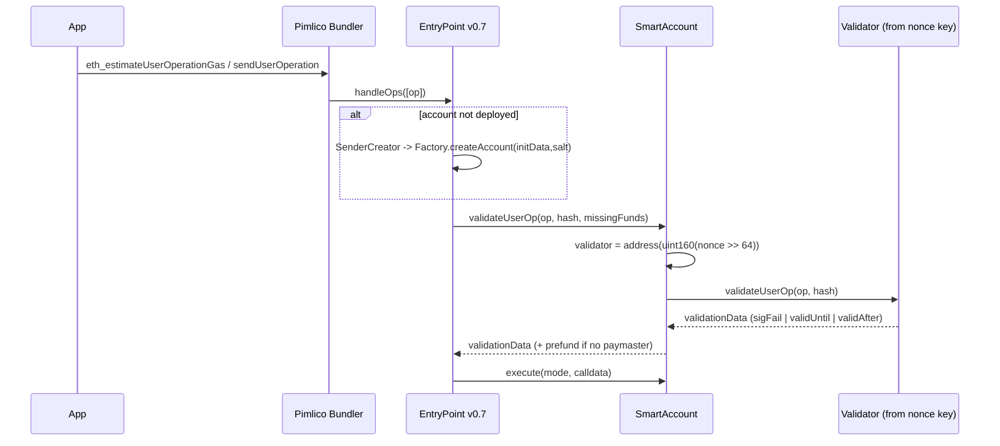
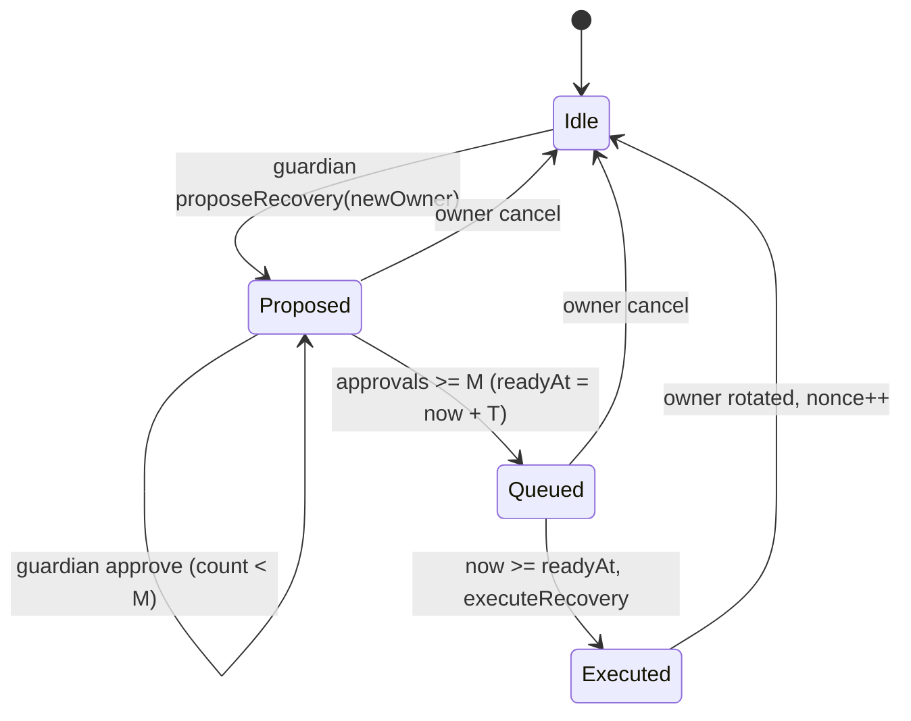
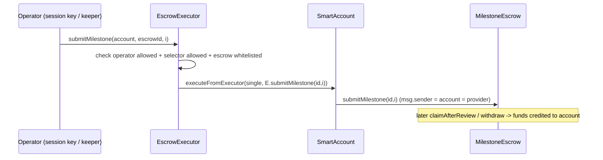

# VaultLite Smart Account — Architecture

Companion to SPEC.md. Chain: Base Sepolia (84532). EntryPoint v0.7 `0x0000000071727De22E5E9d8BAf0edAc6f37da032`
([source](https://github.com/eth-infinitism/account-abstraction/releases)).

## 1. Component overview
```mermaid
flowchart LR
  subgraph Device[VaultLite app (Expo)]
    Seed[Seed phrase -> owner EOA]
    SK[Session key]
    PK[Passkey (future)]
    SDK[viem + permissionless.js]
  end
  SDK -->|eth_sendUserOperation| Bundler[Pimlico bundler]
  SDK -->|pm_getPaymasterData (ERC-7677)| PM[Pimlico paymaster]
  Bundler --> EP[EntryPoint v0.7]
  EP --> F[AccountFactory CREATE2]
  F --> ACC[SmartAccount ERC-7579 proxy]
  EP --> ACC
  ACC --> V1[ECDSAOwnerValidator]
  ACC --> V2[SessionKeyValidator + policies]
  ACC -.-> V3[PasskeyValidator (opt)]
  ACC --> X1[RecoveryExecutor]
  ACC --> X2[EscrowExecutor]
  X2 -->|executeFromExecutor| ACC
  ACC -->|calls as msg.sender| ESC[MilestoneEscrow 0xD861...E528]
```

## 2. Contracts
| Contract | Type | Notes |
|---|---|---|
| `SmartAccount` | ERC-7579 account (OZ building blocks) | UUPS-capable impl behind ERC-1967 proxy |
| `AccountFactory` | factory | CREATE2, `getAddress`, idempotent `createAccount` |
| `ECDSAOwnerValidator` | 7579 type 1 | one owner per account; `rotateOwner` |
| `SessionKeyValidator` | 7579 type 1 | sessions + policies (target/selector, spend, expiry, count) |
| `RecoveryExecutor` | 7579 type 2 | guardians M-of-N, timelock, cancel |
| `EscrowExecutor` | 7579 type 2 | restricted operator calls to MilestoneEscrow |
| `PasskeyValidator` | 7579 type 1 (later) | RIP-7212 precompile w/ Solidity fallback |
| `VerifyingPaymaster` | paymaster (stretch) | signer-approved sponsorship, EP v0.7 `paymasterAndData` layout |

## 3. UserOp validation flow


Validator selection: the 192-bit nonce key carries the validator address (`key = validator << 32 | seq`),
so each validator also gets its own nonce lane — session ops never collide with owner ops.

## 4. Storage & ERC-7562 compliance
Validation-phase storage reads/writes are limited to slots associated with the account
(mappings keyed by `account` address in module storage). Session spend counters therefore live in
`SessionKeyValidator` as `mapping(address account => mapping(bytes32 sessionId => Usage))`.
Account storage uses ERC-7201 namespaced layout to stay upgrade-safe.

## 5. Flows
### 5.1 Recovery


### 5.2 Escrow via executor (provider automation)

Owner path (client): one batched UserOp `[token.approve(E,total), E.createEscrow(...), E.fund(id)]`.
Caveat: `escrowId` is returned by `createEscrow`; in a batch the `fund` call needs the id up front —
predict it from the escrow's counter (read before sending) or split into two ops. Check MilestoneEscrow
source for an `escrowCount`-style getter (to confirm in M5).

## 6. Build vs. extend — detail
| Criterion | Scratch | SimpleAccount | Kernel v3 | Safe7579 | OZ community/5.x AA |
|---|---|---|---|---|---|
| ERC-7579 modules | build all | no | yes | yes | yes |
| Audit pedigree | none | yes (EF samples) | yes | yes | OZ-audited (confirm version) |
| permissionless.js account helper | custom | `toSimpleSmartAccount` | `toKernelSmartAccount` | `toSafeSmartAccount` (+7579) | custom `toSmartAccount` |
| Learning / portfolio value | high | low | medium | medium | high |
| Risk | high | low | low | low | low-medium |
Recommendation: OZ building blocks + own modules (SPEC §6). Pimlico's chain table lists Safe 1.4.1,
Kernel 0.2.x/0.3.x, SimpleAccount, Nexus etc. as supported on Base Sepolia v0.7 ([source](https://docs.pimlico.io/guides/supported-chains)); a custom account is fine
because bundlers are account-agnostic as long as ERC-7562 rules hold.

## 7. Deployment topology (future, not executed)
Deterministic deployment (CREATE2 via the standard deterministic deployer) of implementation, factory,
modules. Factory stake in EntryPoint if needed. No deployments without explicit approval.

## 8. Threat model
| # | Threat | Mitigation |
|---|---|---|
| T1 | Owner key theft (seed leak) | Recovery w/ timelock; owner can still cancel → race. Mitigate further with guardian-veto mode / passkey 2nd factor (later). Documented residual risk. |
| T2 | Malicious/colluding guardians | Threshold M>N/2, timelock T, owner cancel, guardian changes timelocked |
| T3 | Session key over-reach | Target+selector allowlist, spend caps, expiry via validationData, revocation; batches checked per call; `delegatecall` mode disabled |
| T4 | Session key spending via approve | ERC-20 `approve`/`increaseAllowance` counted against cap or disallowed |
| T5 | Signature replay cross-chain/account | userOpHash includes chainId+EP; ERC-1271 uses ERC-7739 nested typed data |
| T6 | Factory front-run / wrong owner init | salt commits to initData; `getAddress` deterministic |
| T7 | Malicious module install | install only by owner validator; module type checks; uninstall always possible for executors |
| T8 | Executor abuse of `executeFromExecutor` | EscrowExecutor immutable target, selector allowlist, operator allowlist, no value-bearing calls |
| T9 | ERC-7562 violation → bundler rejects ops (liveness) | rules lint in tests; fork simulation |
| T10 | Paymaster drain (own PM) | signed validUntil, per-sender limits off-chain, small deposit, key in KMS |
| T11 | Upgrade hijack (UUPS) | `_authorizeUpgrade` owner-only via account self-call; storage namespaced |
| T12 | Gas griefing / unused gas penalty (v0.7 10%) | accurate estimation via bundler |
| T13 | Escrow-specific: arbiter/provider are separate actors in escrow; account can't be both client and provider for same escrow (escrow enforces distinct addresses) | rely on escrow checks |
| T14 | Mobile: seed/session key extraction | SecureStore/Keychain, biometric gating; session keys short-lived |
| T15 | Passkey RIP-7212 absent on target chain | Solidity fallback verifier; detect precompile at install |

## 9. Test plan
**Unit (Foundry)**: each module install/uninstall, validateUserOp success/fail paths, validationData packing,
ERC-1271 positive/negative, factory determinism & idempotence, recovery state machine, executor permissions.

**Fuzz**: session policies (random targets/selectors/values vs allowlist), spend cap accumulation,
timestamps around validAfter/validUntil, recovery timelock boundaries, signature malleability (high-s rejected).

**Invariant** (handler-based):
- I1 only owner-validator or completed recovery can change owner;
- I2 cumulative session spend ≤ cap for every session;
- I3 no executor other than installed ones succeeds on `executeFromExecutor`;
- I4 `factory.getAddress(x) == deployed address` for all created accounts;
- I5 EscrowExecutor never moves value out of the account.

**Fork tests** (`forge test --fork-url $BASE_SEPOLIA_RPC`): use the real EntryPoint v0.7 at
`0x0000000071727De22E5E9d8BAf0edAc6f37da032`; build PackedUserOperations, call `handleOps` from a
beneficiary EOA; cover deploy-via-initCode, batch, session op, paymaster op (stretch), and full escrow
flow against deployed MilestoneEscrow `0xD861…E528` (create → fund → submit → approve → withdraw)
with account as client and another account as provider.

**E2E (manual, testnet, after approval)**: TS script with permissionless.js through Pimlico.

**Static**: Slither, Aderyn; gas snapshots.
