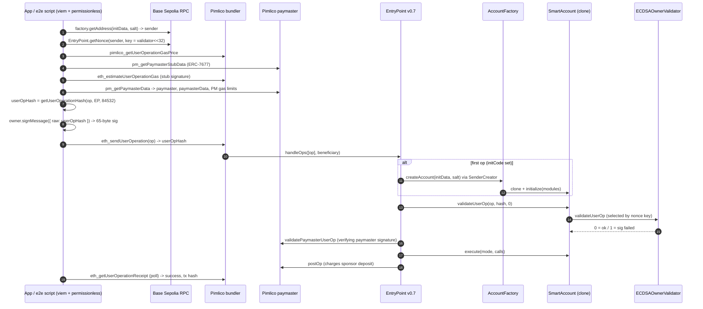

# ERC-4337 flow through Pimlico (Base Sepolia)

How a VaultLite smart-account userOp is built, sponsored, signed, sent and confirmed through Pimlico's bundler and
verifying paymaster, against EntryPoint v0.7. Reference implementation: `e2e/e2e.ts` (viem 2.57 + permissionless 0.5.2).
Testnet only (chain 84532).

## Addresses (Base Sepolia, 84532)
| What | Address |
|---|---|
| EntryPoint v0.7 | `0x0000000071727De22E5E9d8BAf0edAc6f37da032` |
| AccountFactory (staked) | `0xb5c86d7ec6a86074732e8b697a9f90cd8de0eff0` |
| SmartAccount implementation | `0x997f0ffcf65c272bbee57be2f50bb8712f276799` |
| ECDSAOwnerValidator | `0x45b0db483849bf723fe288751297cddc29e7198b` |
| SessionKeyValidator | `0x93a4993b2047862a32864cef09233fdca718b3a2` |
| RecoveryExecutor | `0x5a1c201cc401b0b1d0e213d6e99201939688812c` |
| EscrowExecutor | `0x72a87a92c1373ae3c0f9e42c06e1e6c113d17ec6` |
| MilestoneEscrow | `0xD861488f2ba02df4047DDE41EFeCdCEd1FD6E528` |
| Pimlico paymaster used for sponsorship (observed) | `0x777777777777AeC03fd955926DbF81597e66834C` |

Endpoint: `https://api.pimlico.io/v2/base-sepolia/rpc?apikey=$PIMLICO_API_KEY`. The same URL serves bundler
(`eth_*`, `pimlico_*`) and paymaster (`pm_*`) methods. The key is a secret: scripts read it from the environment, and
the mobile app must reach Pimlico only through a server-side proxy (never `EXPO_PUBLIC_*` in production).

## Sequence


## Step by step
1. **Build.** `initData = SmartAccount.initialize([{1, ECDSA_VALIDATOR, abi.encode(owner)}])`, salt `0x0…0`.
   `sender = factory.getAddress(initData, salt)` (counterfactual). For the first op, `factory`/`factoryData =
   createAccount(initData, salt)` (v0.7 splits `initCode` into these two fields). `callData` is ERC-7579
   `execute(mode, data)`: mode `0x00…` = single (`abi.encodePacked(to, value, data)`), `0x01…` = batch
   (`abi.encode(Execution[])`). Nonce: `EntryPoint.getNonce(sender, uint192(uint160(validator)) << 32)`; the
   validator address in the top 20 bytes of the key is how the account picks the validator.
2. **Gas price.** `pimlico_getUserOperationGasPrice` → use `fast`.
3. **Sponsor.** `createSmartAccountClient({ paymaster: pimlicoClient })` calls ERC-7677 `pm_getPaymasterStubData`,
   estimates with `eth_estimateUserOperationGas` using our stub signature (a well-formed 65-byte sig that recovers to
   a random address: the validator returns SIG_VALIDATION_FAILED instead of reverting, which estimation tolerates),
   then `pm_getPaymasterData` for the final `paymaster`, `paymasterData` and paymaster gas limits.
4. **Sign.** `userOpHash = keccak256(abi.encode(keccak256(packedOpFields), EntryPoint, chainId))` (viem
   `getUserOperationHash`, version 0.7). The owner signs `personal_sign` over the 32 raw bytes:
   `owner.signMessage({ message: { raw: userOpHash } })`, giving `r‖s‖v` with v = 27/28. On-chain:
   `ECDSA.recover(toEthSignedMessageHash(userOpHash), sig) == owner`. Session keys prefix the 32-byte session id.
   The signature is computed after paymaster data is set, because paymaster fields are part of the hash.
5. **Send.** `eth_sendUserOperation` → bundler simulates (ERC-7562 rules), returns the userOpHash.
6. **Confirm.** `eth_getUserOperationReceipt` (permissionless `waitForUserOperationReceipt`) → `success`,
   `receipt.transactionHash`, `paymaster`. `success=false` means validation passed but execution reverted (gas is still
   charged to the sponsor).

## Common errors
| Code | Meaning | Typical cause here / fix |
|---|---|---|
| AA10 | sender already constructed | `factory` fields sent for a deployed account; only send them when `getCode(sender)` is empty. |
| AA13 | initCode failed or OOG | bad `initData` (needs ≥1 validator), factory reverted, low `verificationGasLimit`. |
| AA14 | initCode must return sender | `initData`/salt used for `factoryData` differ from those used for `getAddress`. |
| AA21 | didn't pay prefund | no paymaster and the account has no ETH; check sponsorship was applied. |
| AA22 | expired or not due | session key `validUntil`/`validAfter` window. |
| AA23 | reverted | validator reverted (e.g. malformed session callData) — inspect with simulation. |
| AA24 | signature error | wrong signer, raw signature instead of personal_sign, wrong nonce key/validator, stale hash after changing gas/paymaster fields, session policy violation. |
| AA25 | invalid account nonce | reused or wrong-lane nonce; re-read `getNonce(sender, key)`. |
| AA31 | paymaster deposit too low | Pimlico side; retry / check dashboard. |
| AA33 | reverted (paymaster validation) | paymaster rejected: expired/invalid `paymasterData`, sponsorship policy limits, op changed after `pm_getPaymasterData`. Re-request paymaster data and re-sign. |
| AA34 | signature error (paymaster) | paymaster data signed for different op fields; re-request. |
| AA40/AA41 | over verification gas limit | raise `verificationGasLimit` / paymaster verification gas (re-estimate). |
| AA51 | prefund below actualGasCost | gas price spiked; re-estimate. |

## Why the factory is staked
On the first op the factory runs inside validation: it clones the account and `initialize` calls each module's
`onInstall`, which writes module storage keyed by the new account (e.g. `ECDSAOwnerValidator.ownerOf[account]`).
ERC-7562 rule STO-022 lets validation touch an account's associated storage in another contract **only if the account
already exists or the factory is staked**. Unstaked, bundlers reject the first op during simulation. The factory is
therefore staked in EntryPoint v0.7 with 0.01 ETH and a 1-day unstake delay
(tx `0xf0a77738006fde302e109f0baa61e7467008cd0d5090484804551a670521d0b0`). Staking also gives the factory
reputation-based throttling instead of outright bans. The stake is owner-controlled (`unlockStake` → wait 1 day →
`withdrawStake`).

## One-command demo
```bash
cd e2e && npm ci
PIMLICO_API_KEY=...  npm run demo     # key from env only; never printed (redacted from errors)
```
Generates an ephemeral owner in memory, deploys a fresh account with a sponsored batch op, sends a second sponsored op,
prints Blockscout/JiffyScan links and writes `e2e/demo-results.json` (no secrets).

Recorded run (2026-10-28):
- Account `0x88b07484fCe5B2f42A28199321Dc6c4cBf827aa0` — https://base-sepolia.blockscout.com/address/0x88b07484fCe5B2f42A28199321Dc6c4cBf827aa0
- Op 1 (deploy + batch): userOp `0x0906b474d1fbb7049a3cd0ba12e3da5b788ed1a552cabf2e98b014e44b151064`,
  tx https://base-sepolia.blockscout.com/tx/0xec6d829bbdf4b419680026f931ca0d08ae107278060c9c99e0732005105ad978
- Op 2 (single call): userOp `0x2419685c46062fe9bf381e5954fec5c0e9eeff7206d52019ecbc0a8dcab2dd95`,
  tx https://base-sepolia.blockscout.com/tx/0x90208eccb0c4af9703a488b45f4ef21cfa829336d27af1cf155215bb6cef1d77
- Both sponsored; the account's ETH balance stayed 0.
